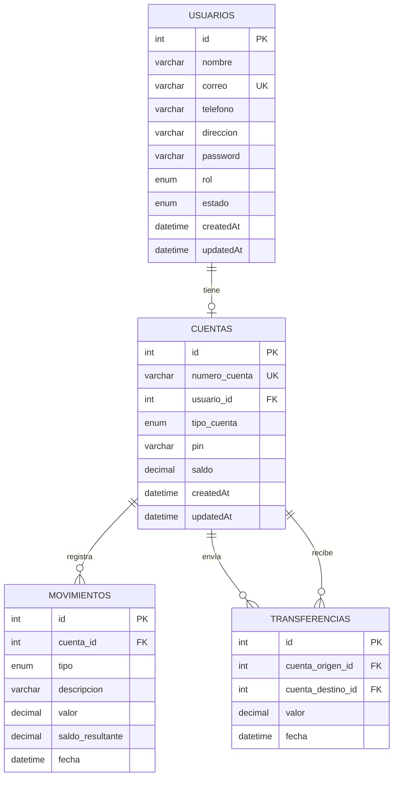

# Simulador Bancario Web

Proyecto Integrador: aplicación web que simula las funciones básicas de un sistema bancario.

## Descripción

El sistema tiene tres módulos que trabajan sobre la **misma base de datos MySQL**, así que cualquier operación hecha en uno se ve de inmediato en los demás:

| Módulo | Para quién | Dirección |
|---|---|---|
| Banca virtual | Cliente del banco | `/cliente.html` |
| Panel administrativo | Personal del banco | `/admin.html` |
| Cajero automático | Cliente, con número de cuenta y PIN | `/cajero.html` |

Ejemplo de la integración: si un cliente con saldo de $1.000.000 retira $200.000 en el cajero, la banca virtual le muestra el saldo de $800.000 y el movimiento *Retiro en cajero* de -$200.000, y el administrador ve ese mismo saldo en la cuenta.

## Integrantes

- Juan David Ibarra
- _Nombre del integrante 2_
- _Nombre del integrante 3_

## Tecnologías utilizadas

| Capa | Tecnologías |
|---|---|
| Backend | Node.js, Express.js |
| Base de datos | MySQL, con Sequelize como ORM (`mysql2` como controlador) |
| Autenticación y seguridad | `express-session` (sesiones y roles), `bcryptjs` (contraseñas y PIN con hash) |
| Validaciones | Joi (en el backend) y validaciones HTML (en los formularios) |
| Configuración | `dotenv` (variables de entorno) |
| Frontend | HTML, JavaScript, Tailwind CSS, Lucide Icons, SweetAlert2, Chart.js (solo en el panel administrativo) y la fuente Plus Jakarta Sans |
| Desarrollo | Git, GitHub, nodemon |

## Requisitos para ejecutar el proyecto

- [Node.js](https://nodejs.org/) 18 o superior (incluye `npm`)
- MySQL 8 o superior (sirve el MySQL de XAMPP)
- Git
- Un navegador actualizado y conexión a internet, porque Tailwind, los íconos, las fuentes, SweetAlert2 y Chart.js se cargan desde CDN

## Instrucciones de instalación

1. Clonar el repositorio e instalar las dependencias del backend:

   ```bash
   git clone https://github.com/Juan130216/proyecto-bancario.git
   cd proyecto-bancario/backend
   npm install
   ```

2. Crear el archivo `.env` a partir del ejemplo:

   ```bash
   # Windows
   copy .env.example .env

   # Linux o macOS
   cp .env.example .env
   ```

3. Abrir `backend/.env` y completar los valores (ver la tabla de la siguiente sección).

## Configuración de la base de datos

1. Encender MySQL (en XAMPP, el botón *Start* de MySQL).
2. Importar el archivo `database.sql` que está en la raíz del proyecto:
   - **phpMyAdmin:** entrar a `http://localhost/phpmyadmin`, abrir la pestaña *Importar* (sin seleccionar ninguna base), elegir `database.sql` y ejecutar.
   - **Terminal:**

     ```bash
     mysql -u root -p < database.sql
     ```

   El script borra y vuelve a crear la base `simulador_bancario`, con sus 4 tablas, sus relaciones y los datos de prueba. Sirve también para restablecer los datos después de hacer pruebas.

3. Configurar las variables de entorno en `backend/.env`:

   | Variable | Descripción | Valor de ejemplo |
   |---|---|---|
   | `PORT` | Puerto del servidor | `3000` |
   | `DB_HOST` | Servidor de MySQL | `localhost` |
   | `DB_PORT` | Puerto de MySQL | `3306` |
   | `DB_DIALECT` | Tipo de base de datos | `mysql` |
   | `DB_NAME` | Nombre de la base | `simulador_bancario` |
   | `DB_USER` | Usuario de MySQL | `root` |
   | `DB_PASSWORD` | Contraseña de MySQL | _(vacía en XAMPP por defecto)_ |
   | `SESSION_SECRET` | Texto largo y secreto para firmar las sesiones | _(cualquier texto difícil de adivinar)_ |

   El archivo `.env` no se sube a GitHub. Solo se sube `.env.example`, sin datos reales.

### Diagrama de la base de datos



- `usuarios.rol` es `ADMIN` o `CLIENTE`, y `usuarios.estado` es `ACTIVO`, `INACTIVO` o `BLOQUEADO`. Los clientes no se eliminan, solo cambian de estado.
- Cada cliente tiene una cuenta. El saldo no puede ser negativo (restricción `CHECK`).
- Los movimientos no se eliminan desde el sistema. Cada uno guarda el saldo resultante.
- Las contraseñas y los PIN se guardan con hash (bcrypt), nunca en texto plano.

## Forma de ejecutar el sistema

Desde la carpeta `backend`:

```bash
npm run dev     # modo desarrollo: se reinicia solo al guardar cambios
npm start       # modo normal
```

Debe aparecer en la consola:

```
Conectado a la base de datos.
Banco: http://localhost:3000
```

Luego abrir `http://localhost:3000` en el navegador. La página de inicio lleva a los tres módulos.

## Usuarios de prueba

| Rol | Correo | Contraseña | Cuenta | PIN del cajero | Saldo inicial |
|---|---|---|---|---|---|
| Administrador | `admin@banco.com` | `Admin123` | — | — | — |
| Cliente | `carlos@correo.com` | `Cliente123` | `1001000001` | `1234` | $1.000.000 |
| Cliente | `laura@correo.com` | `Cliente123` | `1001000002` | `4321` | $2.500.000 |
| Cliente | `andres@correo.com` | `Cliente123` | `1001000003` | `1111` | $500.000 |

## Principales funcionalidades

**Banca virtual (cliente)**
- Iniciar y cerrar sesión
- Consultar saldo disponible, número y tipo de cuenta (el número aparece enmascarado y se puede mostrar)
- Consultar el historial de movimientos: fecha, tipo, descripción, valor y saldo resultante
- Transferir dinero a otras cuentas registradas
- Consultar su información personal, modificar su teléfono y su dirección, y cambiar su contraseña

**Panel administrativo**
- Iniciar y cerrar sesión
- Dashboard: total de clientes, clientes activos, clientes bloqueados y suma de los saldos
- Crear, listar, buscar, consultar en detalle y editar clientes
- Habilitar o bloquear clientes
- Consultar todas las cuentas con su saldo
- Realizar consignaciones
- Consultar el historial general de movimientos

**Cajero automático**
- Ingreso con número de cuenta y PIN
- Consultar saldo
- Retirar dinero, con la verificación de que la cuenta exista, esté activa, el valor sea mayor que cero y haya saldo suficiente
- Consultar los últimos movimientos
- Cerrar la operación

**Reglas de negocio**
- Un cliente solo ve su propia información, porque la cuenta se toma de la sesión y no de lo que envíe el navegador.
- Una cuenta bloqueada no puede iniciar sesión ni realizar operaciones.
- No se aceptan valores iguales o menores que cero, ni retiros o transferencias mayores al saldo.
- Cada consignación, retiro y transferencia genera sus movimientos, y el saldo se modifica solo desde el backend.
- Las operaciones con dinero usan transacciones de base de datos: el saldo y el movimiento se guardan juntos o no se guarda ninguno.
- Las validaciones se hacen en los formularios y también en el backend.

## Estructura del proyecto

```
proyecto-bancario/
├── backend/
│   ├── src/
│   │   ├── baseDatos/       conexión y relaciones de Sequelize
│   │   ├── modelos/         usuario, cuenta, movimiento, transferencia
│   │   ├── servicios/       reglas de negocio y validaciones
│   │   ├── controladores/   reciben la petición y responden
│   │   ├── rutas/           URLs de la API (/api/...)
│   │   ├── acceso.js        control de sesión y roles
│   │   └── app.js           servidor Express
│   ├── .env.example
│   └── package.json
├── frontend/
│   ├── index.html           menú de entrada
│   ├── cliente.html / cliente.js
│   ├── admin.html / admin.js
│   ├── cajero.html / cajero.js
│   ├── funciones.js         funciones compartidas
│   └── css.css
├── database.sql
└── README.md
```

## Notas de uso

- Al reiniciar el servidor se cierran las sesiones abiertas, y hay que iniciar sesión de nuevo.
- La banca virtual y el panel administrativo comparten la sesión del navegador. Para tener ambos abiertos a la vez, usa una ventana de incógnito. El cajero tiene su propia sesión.

## Mejoras futuras

- Recuperación de contraseña: hoy un cliente que la olvida debe contactar al banco. Se podría agregar un botón para que el administrador le restablezca una contraseña temporal.